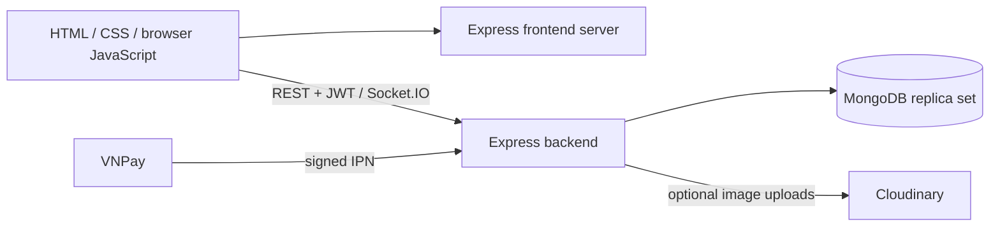

# Clothing Shop

A full-stack clothing store portfolio: customers browse variants, place orders,
track payment results and contact support; administrators manage the catalog and
order lifecycle. The focus is correctness under retries, concurrent stock changes
and unreliable networks.

## Architecture



Node.js 24, Express 5, Mongoose 9, MongoDB 7, Socket.IO 4, Joi, bcrypt,
DOMPurify and Playwright. [Frontend repository](https://github.com/long123123213/ecommerce-frontend).
Both servers run source directly; there is no frontend compilation step.

## Engineering highlights

- Checkout commits the order, item snapshots, stock deductions and cart consumption
  in one transaction. Per-user keys replay committed results; concurrent buyers
  cannot both buy the last unit.
- An explicit order state machine guards payment/cancellation races and restores
  inventory once. Catalog archival preserves order references and purchase snapshots.
- VNPay settlement comes from signed IPN callbacks with unique payment attempts.
  Browser Return is read-only. Reconciliation flags internal mismatches for review;
  it does not query the provider or refund money.
- Authorization checks current user roles/ownership and conversation membership.
  Safe DOM rendering and DOMPurify protect text and supported product rich text.
- Chat retries reuse a client UUID. A database constraint selects one insert;
  duplicate REST/socket requests return that message without another broadcast.
  Reconnect rejoins rooms and merges persisted history by message ID.
- Integration tests use real Mongo transactions, forced concurrency and rollback.
  Chromium E2E covers persisted checkout/chat writes followed by lost responses.

[Batch 8 hardening](docs/batch8-hardening.md) adds separate versioned stock
adjustments, server-enforced payment capability, idempotent payment-link creation,
correct completed-order revenue, password-reset session revocation and auth limits.
Deploy the compatible frontend/backend pair and expect one-time re-login for old JWTs.

## Run locally

Requirements: Git, Node **24.13.1** (npm 11), Docker Engine/Desktop with Linux
containers and Compose v2 supporting `--wait`. Ports 3000, 5000 and 27018 must be free.
Clone the repositories as siblings with these names:

```sh
git clone https://github.com/long123123213/ecommerce-backend.git ClothingShopProject
git clone https://github.com/long123123213/ecommerce-frontend.git ClothingShopProjectFE
cd ClothingShopProject
npm ci
npm run setup:local
docker compose up --build --wait
docker compose run --rm seed
```

Open **http://localhost:3000**; admin login is **/admin/login**. Backend readiness:
http://localhost:5000/health/ready. Use `localhost` consistently for browser URLs.
`setup:local` creates ignored `.env.local` with a fresh JWT secret if absent. It does
not overwrite existing files. The Docker build installs locked production packages.
VNPay and Cloudinary are disabled in this local Compose setup; use COD checkout.

| Account | Email | Local demo password |
| --- | --- | --- |
| Customer | user@demo.example.com | LocalDemo123! |
| Admin | admin@demo.example.com | LocalDemo123! |

Set `DEMO_PASSWORD` in `.env.local` **before first seed** to choose another password.
Seed creates three products, six variants and a customer address. Reruns preserve
existing passwords, stock and edits. It refuses production/remote destinations.
These published credentials are exclusively for a local demo.

`docker compose down` stops the demo while retaining its named database volume.
Replica-set initialization runs only on an uninitialized database; restarts retain
the same configuration/data. This single-node, unauthenticated loopback setup is
for development, not a production Mongo deployment.

For source development, stop the full stack, then use `docker compose up -d --wait mongo`.
In this backend directory run `npm run seed`, then `npm run dev`. In another terminal:

```sh
cd ClothingShopProjectFE
npm ci
npm run setup:local
npm run dev
```

The backend `.env.example` uses host port 27018 and `directConnection=true` so a
host process can reach the Docker replica set. With your own Mongo deployment,
set `MONGO_URI` to a writable replica set or transaction-capable mongos. Standalone
Mongo is rejected before the HTTP server listens; there is no fallback.

## Tests and CI

Run in **each repository**: `npm ci`, `npm run check`, `npm test`,
`npm run scan:secrets` and `npm audit --audit-level=high`. Backend tests download
MongoDB 7.0.24 once into ignored `.cache/mongodb`, use temporary local databases
and never load `.env`. Test ports are ephemeral. From the frontend directory:

```sh
npx playwright install chromium
npm run test:e2e
```

E2E starts both real servers on 4300/4500 and a temporary replica set automatically.
It requires both sibling repos installed; no manually running server or provider
credentials are needed. Linux CI installs Chromium system dependencies with
`npx playwright install --with-deps chromium`. See [test details](test/README.md).

Both repositories have a [CI workflow](.github/workflows/ci.yml): clean install,
syntax/secret/dependency checks, all regression suites, browser E2E, Docker build,
seed twice, smoke and Mongo restart checks. Configure `FRONTEND_REF` here and
`BACKEND_REF` in the frontend repo to compatible branches/tags/SHAs; otherwise CI
uses companion `main`. Manual dispatch can override `companion_ref`. Both releases
must be pushed together before this cross-repository workflow can pass remotely.

## Configuration and deployment

Production uses `npm ci --omit=dev` and `npm start`, with environment variables
injected by the host. `npm run dev` uses Node watch and `.env.local`. Required
variables and optional integration credentials are in [.env.example](.env.example).
The frontend exposes only its public backend origin through `/runtime-config.js`.
No production URL is embedded in browser scripts.

Startup validates config, connects Mongo, verifies topology and awaits indexes
before listening. `/health/live` checks the running process; `/health/ready` checks
Mongo connectivity and a writable transaction-capable topology, returning 503 if
unavailable. See the [deployment checklist](docs/deployment.md) and
[legacy data preparation](docs/legacy-data.md) before using an existing database.

## Limits

No automatic refund, live provider reconciliation API or review-resolution UI;
payment exceptions need operator review. No production observability/load/failover
validation is claimed. Chat recovery is history-based, with in-memory pending
send IDs; a page reload can lose an unacknowledged ID. Socket deployment currently
assumes one backend instance. Some optional UI libraries/fonts still use CDNs.
Browser E2E covers Chromium, not every browser/admin screen or real payment gateway.
